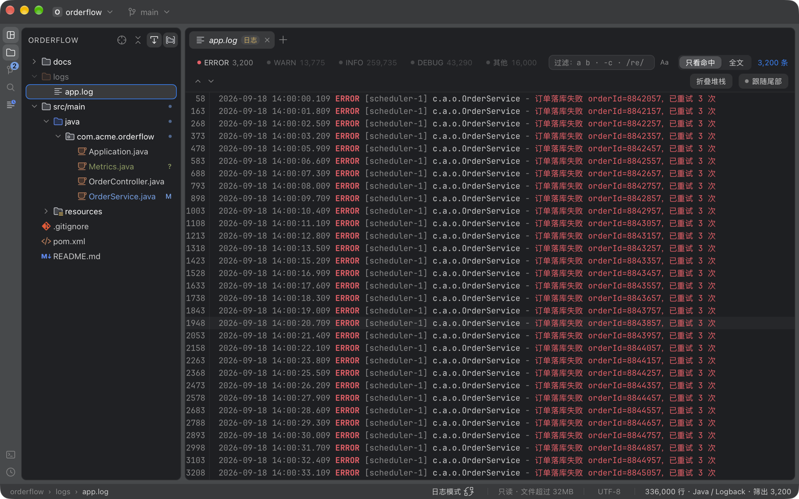
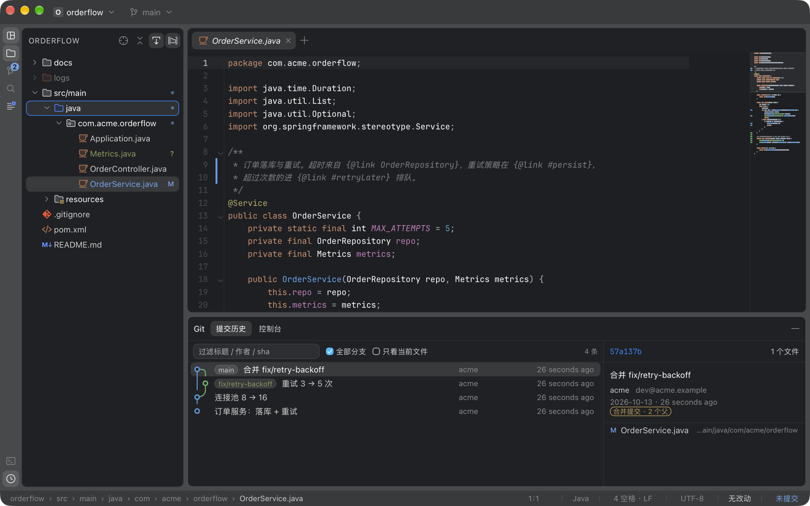
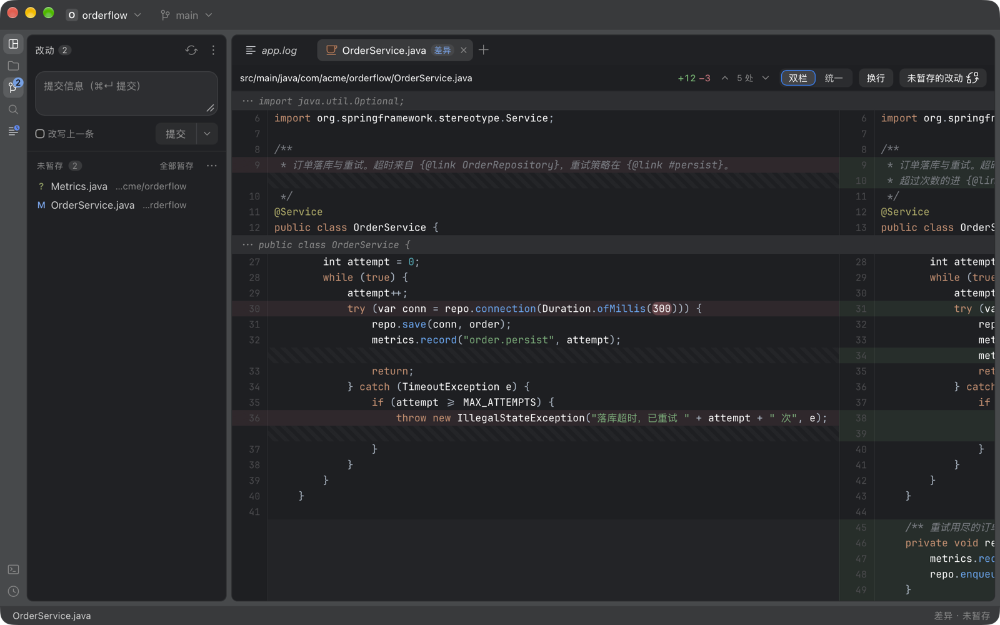
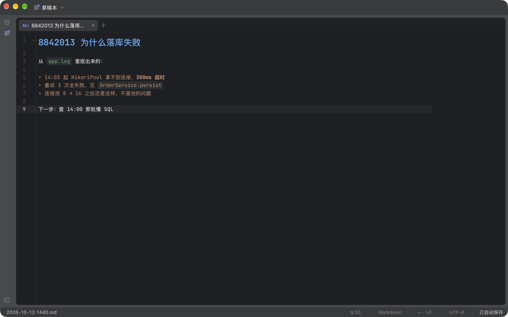

# lite-ide

[](https://github.com/Spc-jgs/lite-ide-mac/actions/workflows/ci.yml)

macOS 上 1 秒打开的个人工作台：**接住 IDEA 里 Java 后端的日常**（补全、跳转、重构、Maven / Gradle、Spring Boot 服务、断点调试、单测、热替换），
同时守住 Sublime 的轻 —— 不开 Java 文件就不起 JVM，GB 级日志秒开不卡。

Tauri 2 + Svelte 5 + CodeMirror 6；Java 智能是内置的 jdtls（Eclipse 的语言服务器）+ java-debug；日志引擎自研（mmap + 稀疏索引）。
**没有遥测，没有「在应用里跑别人代码」的插件。**

> 这是给自己用的工具，公开出来是因为里面几个决定可能对别人有用 ——
> 尤其是「GB 级文件怎么秒开」「什么时候该起子进程而不是链库」「怎么把语言服务器和调试器接得不卡界面」这几件事。
> 它不接受「加个插件市场」这类方向的需求（理由在 [docs/TAKEOVER.md](docs/TAKEOVER.md) 第 9 节 D8）。



| 代码 + 提交历史 | Git 改动 + 双栏差异 |
|---|---|
|  |  |



（示例项目是 `scripts/screenshots.sh` 造的，图也是它拍的 —— 界面改了重跑一遍，图就跟上了。这几张是 2026-10-13 拍的，还没有 Java / 调试那一大块的画面。）

---

## 为什么又造一个

不是因为 VSCode 不好，是因为它在**我最高频的那件事**上是弱项：看几百 MB 到几 GB 的
Java 服务日志。Chromium 的字符串模型决定了大文件要么卡死要么爆内存。而我为了这件事
装一个 IDE，代价是空载 300–500MB、冷启动几秒。

定位：2026-09-24 定的是「取代 Sublime 的那个位置」；2026-10-22 升级成**取代 IDEA（Java 后端为主），同时守住 Sublime 的轻**
（[docs/TAKEOVER.md](docs/TAKEOVER.md)：四方对照、32 个缺口按多久碰一次排、分期）。键位照 IDEA 的 macOS 默认表。具体做的事：

1. **Java 后端** —— 补全（自动 import）、参数提示、⌘B / ⌥⌘B / ⌘U / ⌥F7、F1 文档、⇧⇧ 找类（含 jar 里的）、调用 / 类型层级、改名、抽变量 / 方法 / 常量 / 字段、
   内联、移动类、改签名、生成（⌃↵）、代码模板、照项目的 IDEA 代码风格格式化；**Maven 和 Gradle**：工具窗、Spring Boot 服务（Services，起停、端口、堆用量）、
   **断点调试**（条件 / 日志 / 异常断点、单步、求值、监视、远程 JVM）、**单测**（结果树、边跑边出、调试单测、覆盖率）、⌘F9 构建、**热替换**、运行配置（能从 IDEA 导入）；
   `application.yml` 的键名补全和文档；MyBatis 接口 ↔ XML；`.http` 发请求（[docs/IDEA.md](docs/IDEA.md)）
2. **看 GB 级日志** —— 秒开、按级别过滤、tail、堆栈折叠、堆栈帧跳源码；几个服务的日志按时间合成一条时间线对着看（[docs/MERGE.md](docs/MERGE.md)）；几百万行归成几十类模板，「这一类出现了 2,890 次」，和昨天比哪几类是新出现的（[docs/PATTERNS.md](docs/PATTERNS.md)）
3. **读改代码** —— 67 种语言的高亮与符号大纲，跨文件查找替换（两段提交、能撤销），本地历史，书签 / TODO
4. **随手记** —— 草稿：打开就能记、不用存，Markdown 所见即所得
5. **跑命令** —— 真 pty 终端（能左右拆）；一个键跑任务，输出进日志视图（[docs/TASKS.md](docs/TASKS.md)）

加上一套完整的 Git（改动、历史泳道图、分支、工作树、推拉、双栏差异、冲突解决、做到一半的变基 / 合并、交互式变基、文件和选中几行的历史），一个项目一个窗口；
AI 助手（ACP 宿主，接 Claude Code / Codex，第一版，[docs/AI.md](docs/AI.md)）。

## 实测数字

在 1GB / 9,141,707 行的 Java 日志上（M 系列 Mac，`--release`）：

| | 实测 | 说明 |
|---|---|---|
| 打开耗时 | **0.38 ms** | mmap 是 O(1)，不读盘 |
| 首屏 50 行 | **0.008 ms** | 索引在后台建，不阻塞 |
| 索引全文 | 145 ms | 6.87 GB/s，后台跑 |
| 索引内存 | **69.8 KB** | 每 1024 行一个 checkpoint；全量偏移要 69.7 MB |
| 按级别过滤 | 86 ms | 45.6 万条命中 |
| 常驻内存 | **152–158 MB** 起来时 · 开 12 个文件 207–259 MB | 4 个进程合计，我们自己那个只占 **32–38 MB**，其余是 WebKit。8 轮开关无泄漏 |
| 每多一个窗口 | **+30–120 MB** | 一个项目一个窗口，每个窗口一个 WebKit 渲染进程；多少看开着什么（小文件 30–45 MB，大文件 105–122 MB），跟开了多久无关 |
| 热启动 | **412–429 ms** | 进程起点到会话恢复完、画完；其中入口包只占 57ms |
| 安装包 | `.dmg` 98 MB（本机架构）· universal 约 137 MB | 其中 90 MB 是内置的 Java 智能（jdtls + 裁过的 Java 21，docs/IDEA.md 第 10 节，2026-10-15）；不打开 Java 文件就不起它。之前 4.1 MB（2026-10-10，v1.3.0） |

细节与踩过的坑见 [docs/BENCHMARK.md](docs/BENCHMARK.md)。

## 装

需要 macOS、[Rust](https://rustup.rs)、Node 20+、pnpm，和一个 JDK 21（打包时用它的 `jlink` 裁出内置的运行时）。
第一次打包会下内置 Java 智能要的几样（`scripts/java-bundle.sh`：jdtls 约 49 MB、java-debug、JaCoCo，都钉了版本、核 sha256，缓存在 `~/Library/Caches/lite-ide-build/`）。

```bash
pnpm install
pnpm app:bundle      # 打包
```

产物就在项目目录里，**不往系统里装任何东西**：

```
src-tauri/target/release/bundle/
├── macos/lite-ide.app     ← 双击它就能用，Spotlight 也搜得到
└── dmg/*.dmg              ← 发给别人的
```

刻意不往 `~/Applications` 复制一份：两份 `.app` 只会在 Spotlight 里出现两个
同名条目，而它们迟早分叉 —— 点错的那次，你调的是几天前的构建。

日常开发：

```bash
pnpm app             # Tauri 开发模式（改 Rust 要等重编译）
pnpm dev             # 纯前端 + IPC 桩，改 UI 是毫秒级热更新
```

> `pnpm app:build` 只编可执行文件，**不会更新 `.app`**。
> 拿不准手上跑的是哪个构建：标题栏上把鼠标停在项目名/应用名上，提示里有构建时间。

完整用法、快捷键、卸载见 [docs/USAGE.md](docs/USAGE.md)。

## 两种模式

打开文件时自动判定，判据是复合的：**大小 > 32MB、行数 > 30 万、最长行 > 1 万字符、
含 NUL 字节** —— 任一超标就走只读的日志模式；名字就是日志的（`.log`、`app.log.1` 这类）不管多大也进日志模式。状态栏可以手动切回来。

| | 编辑模式 | 日志模式 |
|---|---|---|
| 引擎 | CodeMirror 6 | 自研 mmap + 稀疏索引 |
| 内存 | 与文件大小成正比 | 与文件大小**无关** |
| 能做 | 编辑、保存、符号大纲、Markdown 预览 | 级别过滤、正则搜索、tail、堆栈折叠 |

这两条路**不共享除主题 token 以外的任何东西**。让 CM6 去扛 GB 级文件，或者让日志视图
支持编辑，都会把两边一起拖垮。

## 几个可能对别人有用的决定

**稀疏索引，不是全量偏移。** 每 1024 行存一个字节偏移，读某一行时从最近的 checkpoint
往前扫。1GB 文件索引占 69.8 KB 而不是 69.7 MB —— 差 1024 倍，这是「内存与文件大小无关」
能不能兑现的分界线。

**数据面走二进制，不走 JSON。** Tauri 的 `invoke` 默认序列化成 JSON，传 1000 行约 15ms；
`tauri::ipc::Response` 传二进制约 1ms。60fps 单帧预算只有 16ms，这个差距是决定性的。

**Git 和搜索都起子进程，不链库。** `.gitignore` 的优先级规则、`core.excludesfile`、
worktree、submodule、rename 检测 —— 自己实现永远在追移动靶，而 git 本身就是这些规则的
定义。代价是每次调用 5–15ms 的进程启动，对「焦点变化时刷新」这种频率完全够用。
libgit2 静态链进来要多 2MB。起子进程的那套纪律（两个管道并发读、输出设闸、丢掉就收尸）收在 `crates/procutil` 一处。

**重的东西一律按需加载。** CM6 约 340KB、xterm 约 250KB、Git 那套约 60KB、67 个语言包 ——
只看日志的人一个都不该付钱。入口包 152 KB（CI 卡 160 KB，超 152 KB 先告警；每轮改动都重量一次、记下是谁涨的，[.claude/rules/frontend.md](.claude/rules/frontend.md)）——
量过启动分段之后这条红线只防退化，不再继续压：它只管启动里 57ms 那一段。

**快照发布，不用读写锁。** 索引在后台线程建，`Mutex<Arc<LineIndex>>` 每次发布一个新快照。
第一版用 `RwLock`，写者饿死读者，首屏要等 1112ms —— 正好是建完整索引的时间。改成快照后
0.008ms。

更多在 [docs/ARCHITECTURE.md](docs/ARCHITECTURE.md)。

## 文档

| | 是什么 |
|---|---|
| [USAGE.md](docs/USAGE.md) | 怎么装、快捷键速查、每个功能怎么用 |
| [TAKEOVER.md](docs/TAKEOVER.md) | 取代 IDEA 还缺什么、分几期做、替用户拍板的那几件（D11） |
| [IDEA.md](docs/IDEA.md) | 接住 IDEA 的 Java 后端日常：语言服务器、Maven、Spring Boot、调试怎么接的，每一步的第 0 步实测 |
| [DIRECTION.md](docs/DIRECTION.md) | 定位、边界、做到哪了、**接下来的优先级** |
| [ARCHITECTURE.md](docs/ARCHITECTURE.md) | 架构决策长什么样，以及对原方案的七处修正 |
| [BENCHMARK.md](docs/BENCHMARK.md) | 性能数字与实现陷阱 |
| [JOURNAL.md](docs/JOURNAL.md) | 时间线上每一步的经过与取舍，含每个踩过的坑 |
| [RELEASE.md](docs/RELEASE.md) | 打包、产物在哪、怎么发版、CI 在做什么 |
| 各功能的设计稿 | [MULTIWINDOW](docs/MULTIWINDOW.md)（多窗口）· [SETTINGS](docs/SETTINGS.md)（设置）· [REPLACE](docs/REPLACE.md)（跨文件替换）· [TASKS](docs/TASKS.md)（任务运行）· [SPLIT](docs/SPLIT.md)（分屏）· [SCRATCH](docs/SCRATCH.md)（草稿）—— 每份都是「拍板的设计 + 第 0 步实测 + 每一步撞见的」 |
| [PLAN.md](PLAN.md) | 立项时的调研与产品方案（历史文档，已被 ARCHITECTURE 和 DIRECTION 修正过） |
| [UNINSTALL.md](UNINSTALL.md) | 怎么卸干净（**草稿在应用数据目录里，删之前先看那一节**） |

## 结构

```
src/                    前端（Svelte 5 + CM6）
  lib/logview/          日志视图：虚拟滚动、块解析、格式识别
  lib/editor/           编辑器：语言表、Markdown 实时预览、缩略图、符号大纲
  lib/git/              Git：改动面板、泳道日志、双栏差异、冲突解决、分支选择器
  lib/shell/            外壳：导轨、侧边栏、文件树、标签栏、底部工具窗、对话框与确认卡片
  lib/run/              运行窗（任务）
  lib/state/            状态层（*.svelte.ts，裸 node 能测）
  lib/dev/mock*         浏览器里的 IPC 桩（按领域分在 mock/），生产构建里被 DEV 常量分支整段删掉

src-tauri/
  src/commands/         命令层：只解包参数和转错误，不写业务（按领域分文件，DTO 在 dto.rs）
  src/state.rs          进程级的资源表，按窗口登记（owned.rs），窗口关了只收它自己的
  crates/logengine/     日志引擎（零 Tauri 依赖，可单独 bench）
  crates/fsservice/     文件读写 + 编码检测 + 文件监听
  crates/gitsvc/        Git（起 git 子进程，带加固参数和信任白名单）
  crates/searchsvc/     文件索引与内容搜索（起 rg，找不到则内置实现）
  crates/replacesvc/    跨文件替换（两段提交 + 撤销日志）
  crates/tasksvc/       任务运行（登录 shell、进程组、先软后硬地停）
  crates/ptysvc/        真 pty（带背压）
  crates/procutil/      起子进程：两个管道并发读、输出设闸、丢掉就收尸
  crates/lspsvc/        语言服务器（jdtls）：JSON-RPC、进程组、空闲收掉
  crates/dapsvc/        调试适配器协议（java-debug）
  crates/hotswap/       热替换（JVM 里的代理 + 盘上 class 的指纹）
  crates/jvmstat/       读 JVM 的堆用量（Services 工具栏）
  crates/histsvc/       本地历史（原始字节存、按编码读回来）
  crates/httpsvc/       `.http` 请求（起 curl）
  crates/acpsvc/        AI 助手的 agent（ACP：按行 JSON-RPC、进程组）
  crates/updsvc/        自动更新（读 latest.json、minisign 验签、换 .app；下载走 curl）
  crates/applog/ excludes/   应用日志 · 哪些目录不进视野
```

十七个 crate 都**不依赖 Tauri**，可以脱离 GUI 单测和跑 bench。这是刻意的：
日志引擎是这个项目唯一的技术未知数，它必须能独立验证；后来的子进程、替换、任务也都照这个办。

## 测试

```bash
cd src-tauri && cargo test --workspace    # Rust 438 条
pnpm check                                # 类型检查
pnpm test                                 # 前端 99 个文件
scripts/smoke.sh                          # 真 .app 端到端 151 条（测试身份、不抢焦点、不碰真实数据）
scripts/accept/*.sh                       # 14 份按领域的验收（真 jdtls / mvn / Gradle / java-debug）：java.sh 94 条、spring.sh 109 条、gradle.sh 27 条……
```

前端测试不引测试框架：纯函数（diff 解析、双栏对照、泳道布局、冲突解析……）直接跑 `.ts`；
状态层（`*.svelte.ts`）用 svelte 自己的编译器编一下就能在裸 node 里跑（`tests/runes/`），IPC 走浏览器里那份桩。
为它们装一套 vitest 加一堆 transform 配置，维护成本比被测代码还高。

有几条规矩是**测试卡着**的，不靠自觉：IPC 两侧的 DTO（`dto_sync`）、菜单和键位表（`menu_sync`）、
哪些命令能留在主线程（`main_thread`）、按窗口登记的资源关窗口时都收（`state.rs`）、页面里不许直接插 HTML（`no-html-sinks`）。

CI 每次 push 都跑这三样，外加一道**入口包体积门禁**（超过 160 KB 就失败）——
「重的东西不进入口包」这条红线很容易在「顺手加个 import」时破掉，
而破了之后没有任何症状，只是启动慢了一点。

## 状态

v1.5.0，日常在用。立项时的 M0–M16、之后的整理 / 多窗口 / 编辑器基本功 / 任务运行做完；取代 IDEA 的分期做到了 MVP-7 的一半
（MVP-0 到 MVP-5 齐了，AI 助手第一版，Gradle、Spring 配置补全、自动更新器做完；声明式集成包、Python / TS、数据库还没做）。
做到哪了、接下来按什么顺序，见 [TAKEOVER.md 第 8 节](docs/TAKEOVER.md)。

## 许可

MIT

内置的第三方素材各自保留原许可：

| 素材 | 来源 | 许可 | 位置 |
|---|---|---|---|
| 界面与文件类型图标 | [JetBrains/intellij-community](https://github.com/JetBrains/intellij-community) 的新 UI 图标 | Apache 2.0 | `public/icons/`（`LICENSE-Apache-2.0.txt`、`NOTICE.txt`、逐个来源见 `SOURCES.md`） |
| 代码字体 JetBrains Mono | [JetBrains/JetBrainsMono](https://github.com/JetBrains/JetBrainsMono) | SIL OFL 1.1 | `public/fonts/`（`OFL.txt`） |
